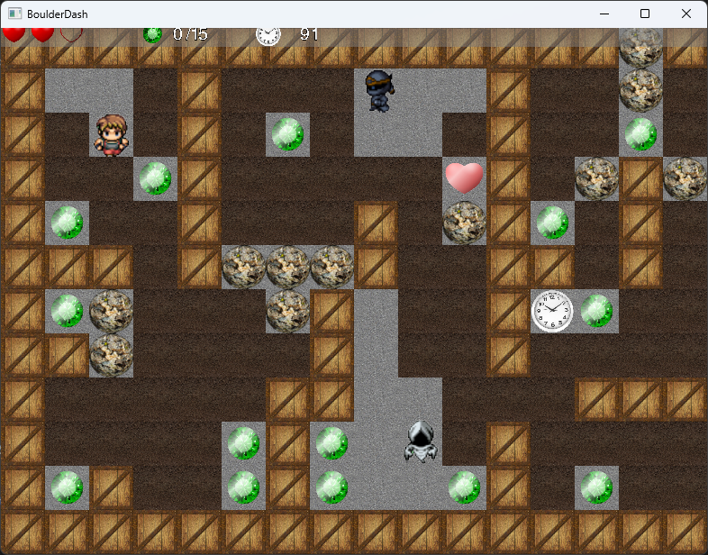

# Boulder Dash

A small 2D game inspired by Boulder Dash.

## About

This is an old pet project, originally written as an experiment in game development and OpenGL rendering.

It was never intended to become a finished product and was mainly used to explore low-level graphics, game loops, and basic engine structure.

## Features

- Tile-based level
- Player movement
- Collectible gems
- Rocks, walls, and obstacles
- Enemies and hazards
- Basic HUD (score, timer, lives)
- Save and load

## Controls

- Arrow keys: move
- Esc: pause (the game can be saved there); Esc again resumes
- Enter: back to the menu when the game is over

## Tech

- C++23
- OpenGL (fixed pipeline)
- Win32 API and WGL: the window, the input, the OpenGL context
- WIC (Windows Imaging Component): loading the PNG images

No third-party libraries.

## Notes

The project reflects a very manual approach:

- custom game loop
- immediate mode rendering (glBegin / glEnd)
- simple texture and sprite handling
- no external engines or frameworks

## Status

Incomplete and abandoned.

Left here as an engineering artifact rather than a finished game.

## Screenshot

## Run

Open `BoulderDash.sln` in Visual Studio 2026 and build it (x64 or x86).

The game finds `Gfx` and `Levels` next to the executable or in a folder above it, so it runs both from Visual Studio and from `BoulderDash\bin\<platform>\<configuration>`.

## Support

If you found this project interesting or useful, you can support my work:

